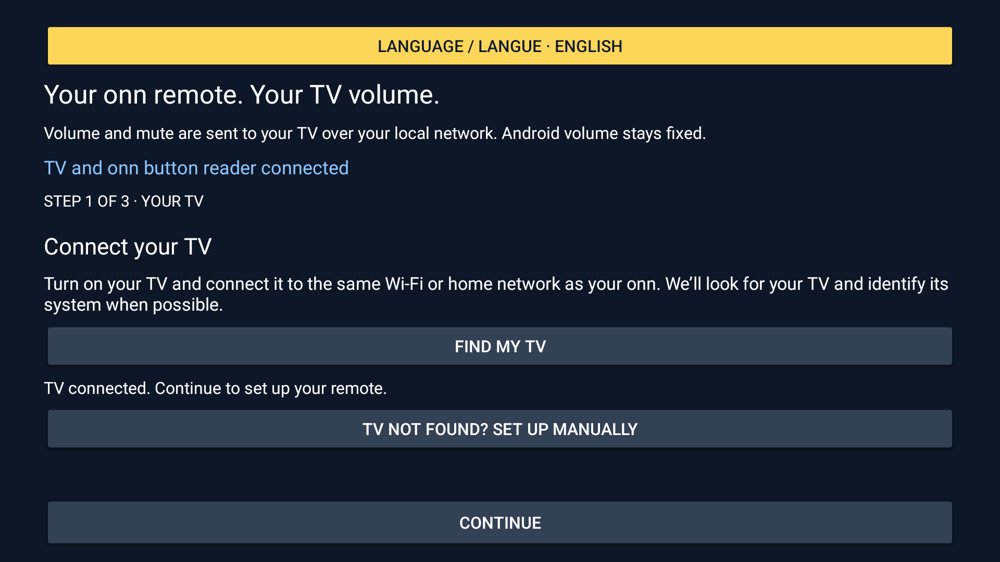
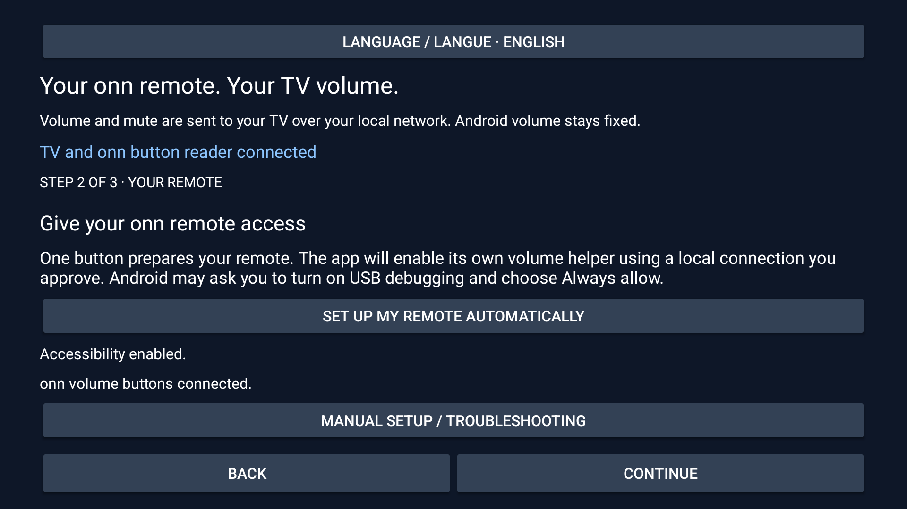
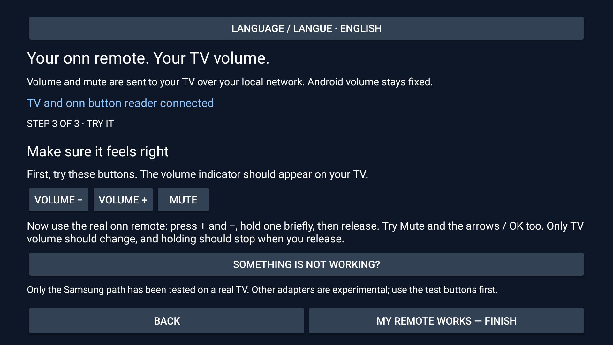

# onn Volume Bridge

Un projet indépendant pour utiliser les boutons **+/− et Muet de la télécommande
onn avec le volume du téléviseur**, lorsque la configuration infrarouge de la box
échoue. Il fonctionne sur le réseau local et ne remplace pas le launcher.

[Documentation principale](README.md) · [Installation](docs/setup.md) · [Compatibilité](docs/compatibility.md)

## Ce qui est prêt

- Moteur de lecture des boutons onn séparé des protocoles des téléviseurs.
- Samsung Tizen : WebSocket chiffré et appairage autorisé sur la télé.
- Roku TV : commandes ECP et maintien natif (keydown/keyup), avec vérification qu’il s’agit d’une télé Roku.
- Sony BRAVIA : API audio JSON-RPC et clé PSK si nécessaire.
- UPnP RenderingControl : mode expérimental pour des points de contrôle compatibles.
- Configuration à la télé en français et en anglais, pause et reconnexion.
- Clés privées et identifiants chiffrés sur l’appareil ; aucune donnée personnelle publiée.

**Les commandes de volume de l’application indépendante ont été confirmées avec
une vraie télécommande onn et une Samsung avec TizenOS : appuis courts, Muet,
maintien et arrêt au relâchement. La validation complète reste à faire pour le
redémarrage, la lecture multimédia et les écouteurs. Roku, Sony et UPnP restent
expérimentaux : leurs tests de protocole ne remplacent pas un essai matériel.**

Le projet ne répare pas l’attestation du service Google et ne programme pas les
codes infrarouges. Il contourne ce chemin avec les commandes réseau du téléviseur.
Une ancienne télé uniquement infrarouge n’est donc pas automatiquement compatible.
LG webOS et d’autres protocoles pourront être ajoutés ; ils ne sont pas annoncés
comme disponibles dans cette première version.

## Installation

**[Télécharger l’APK — aperçu v0.2.1](https://github.com/simo255/onn-volume-bridge/releases/download/v0.2.1/onn-volume-bridge-v0.2.1.apk)** · [Notes et sommes de contrôle](https://github.com/simo255/onn-volume-bridge/releases/tag/v0.2.1)

**Installation facile :** installez [Downloader by AFTVnews](https://play.google.com/store/apps/details?id=com.esaba.downloader)
sur la onn et saisissez **`3237729`**. Ce code télécharge la **v0.2.1** depuis GitHub.
Lien court : [aftv.news/3237729](https://aftv.news/3237729).

**Samsung/TizenOS est le seul environnement ayant des vérifications matérielles consignées.
Les autres adaptateurs TV restent expérimentaux. Tous vos retours et [rapports de compatibilité](https://github.com/simo255/onn-volume-bridge/issues/new?template=compatibility.md)
sont appréciés**, que cela fonctionne ou non. Ne partagez pas d’adresses privées, d’identifiants ou de journaux bruts.

Un problème ? **[Signalez-le sur GitHub](https://github.com/simo255/onn-volume-bridge/issues/new)**
pour que je puisse regarder. Indiquez le modèle de votre onn, le modèle/système de
la télé, la version de l’app, ce qui s’est passé et le résultat attendu.
Ne partagez pas d’adresses privées, d’identifiants ou de journaux bruts.

Installez l’APK sur la onn, choisissez votre télé dans **Find my TV**,
puis **Set up my remote automatically**. Autorisez les demandes Android et testez
la vraie télécommande. L’app active son service de volume après votre autorisation
de débogage local et vérifie le volume HDMI. Un réglage manuel reste nécessaire
uniquement si le système ne permet pas de le vérifier ou de l’appliquer.

L’app s’ouvre en anglais par défaut, même sur une box en français. Le français
se choisit avec **Language / Langue** en haut de l’app, avant la configuration.
Les étapes de débogage et d’appairage imposées par Android et la télé ne peuvent
pas être acceptées silencieusement par l’app. Aucun PC n’est nécessaire à l’usage.
Voir le [guide de configuration](docs/setup.md) pour les détails et limites.

### La configuration en images

| 1. Trouver la télé | 2. Autoriser la télécommande | 3. Tester les boutons |
|---|---|---|
|  |  |  |
| Choisissez votre télé dans les résultats du réseau local. | Suivez les demandes de l’app et d’Android. | Testez les boutons de l’app et la vraie télécommande onn. |

**[Guide illustré pas à pas, en anglais →](docs/visual-guide.md)** · Le bouton en jaune indique l’action sélectionnée.
Les captures montrent l’interface anglaise ; **Language / Langue** permet de choisir le français.
