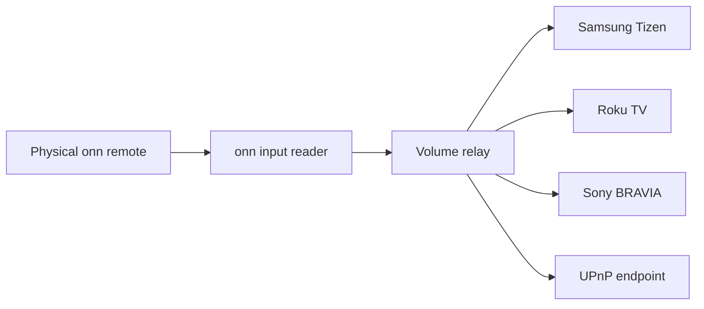

# onn Volume Bridge

Use the **onn remote's volume buttons to control the TV's own volume** when the
built-in remote setup fails. Independent Android app, multiple TV protocols,
local network only, no cloud accounts, no root, and no launcher replacement.

[Français](README.fr.md) · [Setup](docs/setup.md) · [Compatibility](docs/compatibility.md) · [Architecture](docs/architecture.md)

## Download and setup

**[Download the APK — v0.2.2 preview](https://github.com/simo255/onn-volume-bridge/releases/download/v0.2.2/onn-volume-bridge-v0.2.2.apk)** · [Release notes and checksums](https://github.com/simo255/onn-volume-bridge/releases/tag/v0.2.2)

**Samsung/TizenOS is the only setup with recorded hardware checks. Other TV adapters
are still experimental. Feedback and [compatibility reports](https://github.com/simo255/onn-volume-bridge/issues/new?template=compatibility.md)
are appreciated**, including what works and what needs fixing. Please omit private addresses, credentials and raw logs.

Found an issue? **[Report it on GitHub](https://github.com/simo255/onn-volume-bridge/issues/new)**
so I can take a look. Include the app version, generic TV system, what happened
and what you expected. Exact device/TV models are optional. Keep private addresses,
credentials and raw logs out of the report.

**Report a problem** previews generic technical diagnostics and offers phone QR
sharing for Reddit or a GitHub draft. See [how reporting works](docs/setup.md#reporting-a-problem).

Install on your onn, choose your TV from **Find my TV**, then select
**Set up my remote automatically**. Approve the Android prompts and try the remote.
The app handles its own accessibility setup after local debugging approval and
checks fixed HDMI volume. It opens remote settings only if a manual step remains.
English is the default; the language selector at the top also offers French. No PC is needed
for normal use. See [setup and recovery](docs/setup.md) for installation and limits.

### Setup at a glance

| 1. Find your TV | 2. Authorize your remote | 3. Try the buttons |
|---|---|---|
|  |  |  |
| Choose your TV from the local network results. | Follow the app and Android permission prompts. | Test the app buttons and your real onn remote. |

**[Follow the screenshot guide →](docs/visual-guide.md)** · Amber buttons show which action is focused.

## Why it exists

On an onn Streaming Device 4K Pro running Android TV 12, adding a TV in
**Set up remote buttons** failed with **Something went wrong**. The infrared
service log reported `Unable to attest device ids`. Power via HDMI-CEC worked,
but TV volume did not.

This project works around the broken configuration path. It **does not repair
Google's infrared service or reprogram the remote's IR codes**. Instead, it reads
volume presses on the box and sends volume commands to a supported TV on the LAN.
TVs that only accept infrared and expose no supported network volume API need
another approach; the project does not claim support for every TV.

## Current compatibility

| TV protocol | Implementation | Hardware validation |
|---|---|---|
| Samsung Tizen | Paired TLS WebSocket, pinned TV certificate | Independent-app core volume, mute and held-button release confirmed with Samsung / TizenOS |
| Roku TV | ECP volume/mute and native keydown/keyup; TV endpoint verification | Experimental; protocol and local-server tests only |
| Sony BRAVIA | Audio JSON-RPC with optional PSK, relative speaker volume and mute | Experimental; protocol tests only |
| UPnP RenderingControl | Explicit local endpoint, 0–100 volume and mute | Experimental; read capability alone does not establish write support |

The independent app's core volume controls have now been checked with a real onn
remote and a Samsung TV with TizenOS, including held buttons and release. The full
acceptance checklist (including reboot, playback and headphones) is still pending.
The other adapters need community hardware reports. LG webOS SSAP and other systems
can be added through the adapter interface; they are not implemented yet.
See [native hold support and research](docs/native-hold.md), the [compatibility matrix](docs/compatibility.md) and [scoped hardware report](docs/validation.md) before enabling relaying.

The brand on the bezel is not the protocol: for example, a TCL or Hisense TV
running Roku OS uses the Roku adapter. Android/Google TV by itself does not imply
Sony BRAVIA API support.

## How it works



- Volume +/− come from an authorized **loopback ADB** connection on the box.
- Mute is filtered by an accessibility service; it cannot read screen contents.
- The input reader discovers the event node by interface name and capabilities.
  It prefers **Onn-Remote Keyboard**, the interface observed carrying volume;
  **Consumer Control** carried navigation and mute on the tested remote.
- The box's HDMI audio remains fixed. There is **no Android volume observer or
  recentering trick**, and no repeated modification of the box's volume.
- The app sends only volume up, volume down and mute to the selected TV.

## Build and try

Requirements: JDK 17, Android SDK 34 / build-tools 34.0.0, Android platform-tools.
The app targets Android 8.0+; firmware support for local ADB still varies.

```sh
./gradlew --no-daemon testReleaseUnitTest lintRelease assembleRelease
adb -s <box endpoint> install app/build/outputs/apk/release/app-release.apk
```

On Windows, use `gradlew.bat`. Set your own SDK location through Android Studio,
`ANDROID_HOME`, or an ignored `local.properties` file.

Follow the in-app setup: connect the TV, run automatic remote setup, then test
short presses and holding with the physical onn remote. Android debugging approval
and on-TV pairing remain explicit; manual setup is available when firmware refuses
a setting. [Detailed instructions](docs/setup.md).

Use the bridge when normal CEC volume does not work. If CEC already changes your
TV's volume, it can duplicate commands; leave this relay disabled and use CEC.
Keep the box and TV on the same LAN and debugging enabled. No PC is needed during
normal use after setup. Reboot/reconnect behavior still needs verification per
firmware; **Reconnect TV and button reader** retries a stopped connection.

[Detailed setup and recovery](docs/setup.md) · [optional desktop configuration tool](tools/configure.py)

## Privacy and permissions

`INTERNET` is the only ordinary permission. The accessibility binding is used to
keep the relay available and handle mute; window-content retrieval is disabled.

The app's ADB client is hardcoded to **127.0.0.1:5555**, uses an on-device generated
RSA identity, and requires Android's approval. Its private key is encrypted with
Android Keystore. The explicit automatic-setup action uses fixed shell operations
to add only this app to accessibility and inspect HDMI volume behavior; normal
button monitoring remains read-only. Samsung tokens and Sony PSKs are encrypted too. Cloud backup,
device transfer and app-data backup are disabled.

Enabling debugging may expose the box's ADB listener to your LAN, depending on
firmware. The app's loopback restriction does not close that listener. Use an
owner-controlled, trusted network. Disabling debugging also disables raw-button
reading. This is an owner-approved shell capability, not a root exploit.

TV addresses must be literal private IPv4 addresses. HTTP redirects are rejected,
responses and queues are bounded, and stale queued presses are dropped. Samsung
uses pinned TLS after explicit initial trust. Roku/Sony/UPnP use their local HTTP
APIs; Sony PSKs therefore travel over your trusted LAN using Sony's API.
No analytics, screen recording, typed-text logging or public-network service.

## Development and contribution

ZXing core generates report QR codes locally; the remaining runtime uses Android/Java APIs.
JUnit and JSON are used only in JVM tests. A signed public preview APK is available in GitHub Releases.
Local builds use the builder's developer identity by default; published builds can
use an external private keystore. See [build and signing](docs/setup.md#build-from-source-or-configure-from-a-computer).

Add a provider through `TvProtocol` / `VolumeTarget`, with protocol tests and an
honest compatibility entry. [Contributor guide](CONTRIBUTING.md).

Hardware reports are welcome through the repository's compatibility issue form.
Share only model, OS, firmware, app version, protocol and observed button behavior.
Do **not** attach IP addresses, account names, tokens, ADB keys, complete device
backups or raw input captures.

MIT license. See [NOTICE](NOTICE) for the source of the original fix.
