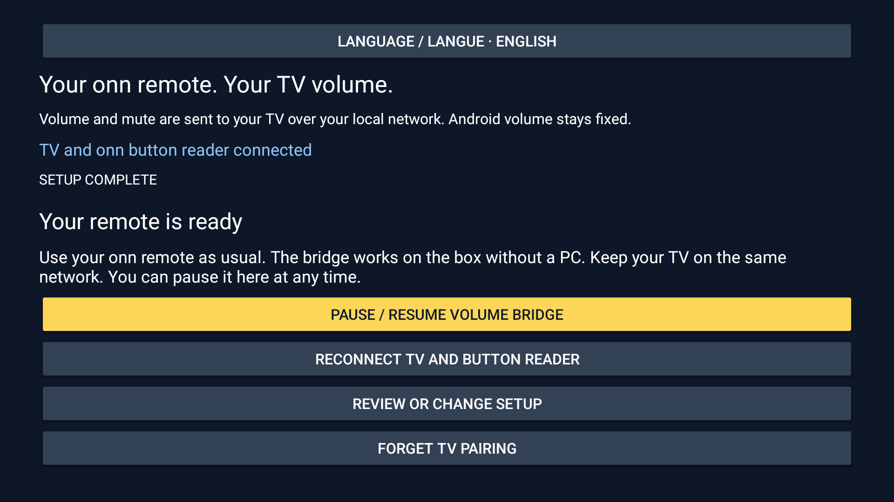

# Set up in three steps

For the easiest remote-only install, use **Downloader by AFTVnews** on the onn and
enter **`3237729`**. This code points to the official v0.2.1 APK on GitHub.
See [installation instructions](setup.md#download) if Android asks for permission.

Or install the [v0.2.1 preview APK](https://github.com/simo255/onn-volume-bridge/releases/download/v0.2.1/onn-volume-bridge-v0.2.1.apk)
on your onn and open **onn Volume Bridge**. Keep your TV on and connected to the
same Wi-Fi or home network. Use this bridge when normal CEC volume setup fails.

These screenshots show the app on an already paired onn and Samsung/TizenOS TV.
On a first installation, Android permissions and TV approval are still required.
An amber button is focused: press **OK** to select it.

## 1. Find your TV

Choose your language with **Language / Langue** at the top. Select **Find my TV**,
then choose your TV from the results. The app identifies the TV system when the
device advertises it; you do not need to choose a brand first.

For Samsung, approve certificate trust in the app and choose **Allow** on the TV
when asked about **onn Volume**. The app advances once connected.

If your TV is missing, select **TV not found? Set up manually**. If a device does
not identify its system, the app asks you to choose. Sony may require an IP-control
key; UPnP requires a writable control endpoint. These adapters remain experimental.

## 2. Authorize your remote

Select **Set up my remote automatically**. If requested, turn on **USB debugging**
in Android Developer options, then return to the app. In Android's debugging
prompt, select **Always allow** and **Allow**.

The app enables its own accessibility helper through the connection you approve
and checks fixed HDMI volume. If a manual setting is needed, follow the prompt.
**Manual setup / troubleshooting** exposes the individual controls.

## 3. Try the remote

Try the app's **Volume +**, **Volume −** and **Mute** buttons. Then test your real
onn remote: short presses, a brief hold and release, mute, and normal arrows/OK.
Only the TV volume should change, and holding must stop when you release.

When your real remote works, choose **My remote works — finish**. If something
fails, choose **Something is not working?** for help.

## Ready for everyday use

Keep the TV and box on the same trusted network and leave debugging enabled.
No PC is needed during normal use. Pause or reconnect from this screen whenever
needed; **Review or change setup** returns to the wizard.

Samsung core volume, mute and hold/release have recorded hardware checks. Full
reboot, playback/headphones and network recovery acceptance remain pending.
Roku, Sony and UPnP have protocol tests, not hardware acceptance reports.
See [compatibility](compatibility.md) and [detailed setup and recovery](setup.md).
